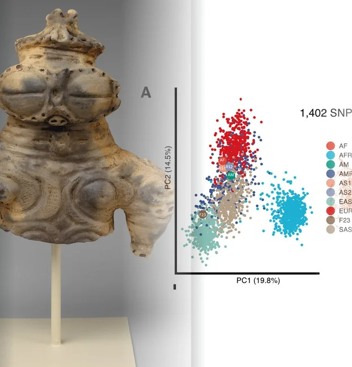

Genetic component of intelligence in ancient people
===================
Repository contributing to a manuscript "[Inferring intelligence of ancient people based on modern genomic studies](https://www.nature.com/articles/s10038-022-01039-8)"
 (accepted for publication in the Journal of Human Genetics, 2022)
-------------------
Authors:
Kaisar Dauyey and Naruya Saitou

*Final Jōmon dogū figurine (The Metropolitan Museum of Art, accession 1975.268.191, CC0) beside the PCA of 1,402 intelligence-associated SNPs from the paper (Fig. 3A). Collage reused from [Kaisar's research website](https://kays3.github.io/).*

# Contents

1. Polygenic score calculations
2. Absolute score derivation of IQ based on polygenic predictions
3. Genetic relationship analysis based on PCA and SNPs assocaited with intelligence
4. Ancestral state of effective alleles demonstrated by ORTHEUS alignment

## License
All files are licensed under the [MIT license](http://opensource.org/licenses/MIT). This project may not be copied, modified, or distributed except according to those terms.
